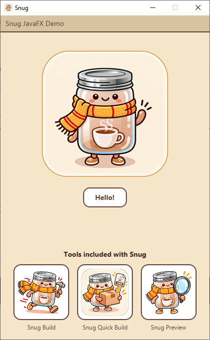

# Snug JavaFX Demo

---

<p align="center">
  
</p>

> A minimal JavaFX 25 application used as a demo target 
> for [**snug**](https://github.com/synapticloop/snug) — the snug application packager.

> It exists to give `snug` something real (and small) to package into a 
> native self-contained desktop app.

---

## What it does

A single window with the snug logo, a "Hello!" button, and a "Snug Tools" row:

- **Click the button** → the logo plays a short wave animation (3 logo↔wave cycles) and the welcome label updates.
- **Click the logo on the coffee cup** → the welcome label says "Mmmmm - coffee".
- **Click the logo anywhere else** → it briefly switches to a surprised "ooh" variant, then snaps back to the logo after a second of no clicks.
- **The "Snug JavaFX Demo" menu** → an About dialog (logo, version), and Quit.
- **Click a "Snug Tools" tile** → a modal explaining what that snug tool 
  does, titled to match the tile's caption. 

  Quit is bound to the platform's normal modifier key plus `Q` — `⌘Q` on macOS,
  `Ctrl+Q` elsewhere. The accelerator is declared once in the FXML as
  `accelerator="Shortcut+Q"`; JavaFX resolves and renders `Shortcut` per
  platform, so there is no per-OS code.

  On macOS the bar moves out of the window and into the Apple menu bar
  (`MenuBar.setUseSystemMenuBar(true)`, set from `HelloController.initialize()`
  behind an OS check). JavaFX converts the items to a native `NSMenu`,
  accelerators included, so `⌘Q` is a real key equivalent. Windows and Linux
  have no system menu bar in Glass, so they keep the in-window bar. The FXML
  must stay on `MenuItem` / `SeparatorMenuItem` — JavaFX silently ignores the
  hand-over if a `CustomMenuItem` is ever added.

## Build & run

Requires JDK 25 (the Gradle toolchain will provision it).

```sh
./gradlew run              # run from source
./gradlew shadowJar        # build build/libs/snug-javafx-demo-<os>.jar
java -jar build/libs/snug-javafx-demo-windows.jar
```

The shadow jar is named after the platform it was built on, so the same
source can produce all three without one overwriting another:

| build host | artifact |
| --- | --- |
| Windows | `build/libs/snug-javafx-demo-windows.jar` |
| macOS | `build/libs/snug-javafx-demo-macos.jar` |
| Linux | `build/libs/snug-javafx-demo-linux.jar` |

Each jar embeds that host's JavaFX natives, so a jar is only runnable on the
platform it was built for.

## About snug

This project is a smoke-test fixture for [snug](https://github.com/synapticloop/snug), 
a tool for wrapping JVM applications as standalone native applications. The 
same demo is built and exercised by both the snug Windows builder and the snug 
macOS builder. See the snug repo for the actual packaging instructions.

---

<div align="center">

<p><strong>Say Hello to Snug.</strong></p>
</div>

---
